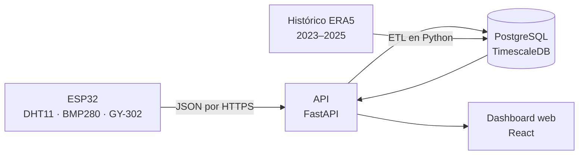

# 🌡️ Monitoreo Microclimático de Querétaro

> Estación meteorológica IoT de bajo costo que mide, en tiempo real, el microclima del centro histórico de Querétaro y lo compara con 3 años de datos de reanálisis climático (ERA5) para detectar el efecto de **isla de calor urbana**.


---

## 📌 El problema

Los datos climáticos regionales (satélites y modelos de reanálisis) representan áreas de decenas de kilómetros. Dentro de una ciudad, el asfalto, los edificios y la falta de vegetación pueden calentar el aire varios grados por encima de lo que esos modelos indican. **¿Cuánto más caliente está realmente el centro de Querétaro?**

## 💡 La solución

Un sistema de tres capas:

1. **Hardware** — un ESP32 con sensores de temperatura, humedad, presión y luz instalado en el centro de la ciudad.
2. **API** — recibe las lecturas por WiFi, las valida y las guarda en una base de datos de series de tiempo.
3. **Web** — un dashboard que compara, hora por hora, la medición real de la calle con el histórico regional.



## 📊 Metodología de comparación

| Comparación | Pregunta que responde |
|---|---|
| **Sensor vs. climatología** (promedio de 3 años para el mismo mes y hora) | ¿Hoy está más caliente de lo normal para esta época? |
| **Sensor vs. modelo en el mismo instante** | ¿Cuántos grados más caliente está la calle que la región en este momento? (indicador de isla de calor) |

## 🔧 Hardware

| Componente | Variable | Precisión aproximada |
|---|---|---|
| ESP32 | Microcontrolador con WiFi | — |
| DHT11 | Temperatura / humedad relativa | ±2 °C / ±5 % HR |
| BMP280 | Presión atmosférica (y temperatura de referencia) | ±1 hPa / ±1 °C |
| GY-302 (BH1750) | Iluminancia (lux) | — |

> ⚠️ **Limitaciones conocidas:** la precisión del DHT11 (±2 °C) es del mismo orden que el efecto que se quiere medir, por eso se reporta siempre la incertidumbre y se usa la temperatura del BMP280 como referencia cruzada. El BH1750 mide luz visible en lux, no radiación solar en W/m²; la conversión (~lux ÷ 120) es una aproximación válida solo para luz solar directa.

## 🗂️ Estructura del repositorio

```
├── data/                    # Datos crudos (no se suben a GitHub)
├── data_science/
│   ├── etl_satelite.py          # Limpieza y estandarización del histórico ERA5
│   ├── corregir_humedad_era5.py # Reemplaza la humedad por humedad relativa de ERA5
│   ├── eda_historico.py         # Análisis exploratorio y umbrales
│   └── alineacion_temporal.py   # Cruce sensor vs. histórico
├── iot/                     # Firmware del ESP32 e ingesta
├── docs/                    # Diagramas y fotos del hardware
├── docker-compose.yml       # Base de datos (y próximamente la API)
├── .env.example             # Plantilla de variables de entorno
└── requirements.txt
```

## 🚀 Cómo ejecutarlo

**Requisitos:** Python 3.12+, Docker Desktop y Git.

```bash
# 1. Clonar el repositorio
git clone https://github.com/marialuisaas/monitoreo-microclimatico-queretaro.git
cd monitoreo-microclimatico-queretaro

# 2. Crear el entorno virtual e instalar dependencias
python -m venv .venv
source .venv/Scripts/activate      # Windows (Git Bash). En Linux/Mac: source .venv/bin/activate
pip install -r requirements.txt

# 3. Configurar las variables de entorno
cp .env.example .env               # y editar .env con contraseñas propias

# 4. Levantar la base de datos
docker compose up -d

# 5. Procesar el histórico (requiere data/Datos_Climaticos_Completos.csv)
python data_science/etl_satelite.py
python data_science/corregir_humedad_era5.py
python data_science/eda_historico.py
```

## 🛣️ Hoja de ruta

- [x] Estructura del repositorio y políticas de seguridad
- [x] ETL del histórico ERA5 (26 304 registros horarios, 2023–2025)
- [x] Corrección de la humedad relativa con datos ERA5
- [ ] Climatología mensual-horaria y carga a PostgreSQL
- [ ] API REST con FastAPI (recepción y consulta de lecturas)
- [ ] Firmware del ESP32 enviando datos a la API
- [ ] Cálculo de la brecha térmica (sensor vs. modelo)
- [ ] Dashboard web en React
- [ ] Despliegue en la nube e integración continua

## 📚 Fuentes de datos

- **ERA5 / ERA5-Land** — reanálisis climático del programa Copernicus (ECMWF), obtenido vía [Open-Meteo](https://open-meteo.com/) (uso no comercial).

## 👥 Equipo

| Nombre | Rol |
|---|---|
| Maria Luísa | Ciencia de datos · IoT |
| _Integrante 2_ | _Rol_ |
| _Integrante 3_ | _Rol_ |

## 📄 Licencia

Distribuido bajo la licencia MIT. Ver [LICENSE](LICENSE).
